# Goal Model — Sprint 1 (V1) and V2 revision

**Source model:** HW2 combined goal model (G-1 to G-36). G-38, G-42 and G-43 are new in this sprint.
**V2:** V2 adds G-18/G-19 (resolve uncertain doses) after V1 evaluation, with G-20 (see §6).
**Sprint theme:** Dose confirmation and risk-based missed/duplicate-dose alerts

## 1. Sprint Scope

| Criterion | How the scope meets it |
|---|---|
| **Core feature** | Remind, confirm, record, flag and alert is the main safety loop. Harold's hospitalization came from a double blood-thinner dose (T2:14; F2:7), and all three stakeholders rank this first (T1:44; T2:45; T3:65). |
| **User-facing** | Harold's large-text tablet view with one-tap confirm, and Rachel's alert view. |
| **High uncertainty** | "Missed" is defined differently by each stakeholder, alert urgency depends on the medication, and Rachel's access is limited by consent. V1 tests whether per-medication windows match what stakeholders call "missed", whether two urgency levels avoid over-alerting, and whether the consent tiers give Rachel enough to act on. |

### Goals to build

| ID | Goal | Agent | Evidence |
|---|---|---|---|
| G-4 | ReminderGiven **If** DoseDue | App | T1:48; F1:6, F1:12 |
| G-7 | DoseConfirmedWithOneTap **If** DoseTaken | Harold | T1:14; F1:37; F2:36 |
| G-8 | TakenTimeStored **If** DoseConfirmed | App | F1:37; T2:17 |
| G-17 | LastTakenTimeShown | App | T1:44 |
| G-43 | DoseMarkedUnsure **If** HaroldCannotRemember | Harold | T1:44; F2:20, F2:22 |
| G-38 | WindowAndRiskLevelSetPerMedication | Dr. Nguyen | T3:39, T3:59, T3:70 |
| G-22 | DoseFlagged **If** RecordedTwice **Or** MarkedUnsure **Or** NotRecordedInWindow | App | T2:14, T2:17; T3:57 |
| G-24 | UrgentAlertSent **If** DoseFlagged **And** HighRisk | App | T2:45; T3:59, T3:88 |
| G-25 | RoutineNoticeShownToHarold **If** DoseFlagged **And** LowRisk | App | T3:59, T3:86 |
| G-34 | **Avoid** RachelAlerted **If** DoseSlightlyLate | App | T1:46; F1:29, F1:49 |
| G-33 | RachelViewLimitedToHaroldChoices | App | T1:28; F1:23 |
| G-42 | RachelDesignatedSafetyContact **If** HaroldOptsIn | Harold | T1:46; T3:33 |
| G-36 | LargeTextAndButtons | App | F1:12, F1:41 |

**Added in V2** (see §6)

| ID | Goal | Agent | Evidence |
|---|---|---|---|
| G-18 | DoseStatusResolved **If** DoseStatusUncertain | — (parent, refined into G-19 and G-20) | T1:44; F2:22 |
| G-19 | PharmacistAdviceGiven **If** DoseFlagged | Dr. Nguyen | T1:44; F2:22, F2:34 |
| G-20 | DoseWithheld **Until** Advised | Harold | T1:44 |

## 2. Sprint Goal Model

Parallelogram = goal, hexagon = agent. "complete" = complete AND-refinement, "partial" = incomplete AND-refinement; separate arrows into one goal are OR-alternatives; grey dashed = rejected; dotted labeled lines = the conflicts and trade-off in §4; blue fill = goals added to the build in V2; amber fill = softgoals added for the A4 change requests, with dotted "helps" arrows to the goals they serve (§7).

```mermaid
flowchart BT
  %% Goals
  G1[/"G-1: Maintain HaroldMedicationSafe"/]
  G3[/"G-3: DoseTakenAndRecorded If DoseDue"/]
  G6[/"G-6: DoseRecorded If DoseTaken"/]
  G4[/"G-4: ReminderGiven If DoseDue"/]
  G7[/"G-7: DoseConfirmedWithOneTap"/]
  G8[/"G-8: TakenTimeStored"/]
  G16[/"G-16: Avoid DoubleDoseTaken"/]
  G17[/"G-17: LastTakenTimeShown"/]
  G18[/"G-18: DoseStatusResolved If DoseStatusUncertain"/]
  G43[/"G-43: DoseMarkedUnsure If HaroldCannotRemember"/]
  G19[/"G-19: PharmacistAdviceGiven If DoseFlagged"/]
  G20[/"G-20: DoseWithheld Until Advised"/]
  G21[/"G-21: DoseIssueAlerted If MissedOrDuplicated"/]
  G38[/"G-38: WindowAndRiskLevelSetPerMedication"/]
  G22[/"G-22: DoseFlagged If RecordedTwice Or Unsure Or NotInWindow"/]
  G23[/"G-23: ResponsiblePersonAlerted If DoseFlagged"/]
  G24[/"G-24: UrgentAlertSent If HighRisk"/]
  G25[/"G-25: RoutineNoticeToHarold If LowRisk"/]
  G26[/"G-26: RachelAlertedImmediately (rejected)"/]
  G30[/"G-30: Avoid FamilyAccess Beyond HaroldConsent"/]
  G33[/"G-33: RachelViewLimitedToHaroldChoices"/]
  G42[/"G-42: RachelSafetyContact If HaroldOptsIn"/]
  G31[/"G-31: Maximize HaroldIndependence (soft)"/]
  G34[/"G-34: Avoid RachelAlerted If SlightlyLate"/]
  G35[/"G-35: Maximize Readability (soft)"/]
  G36[/"G-36: LargeTextAndButtons"/]
  G44[/"G-44: Minimize DrNguyenEffortToAnswerFlags (soft)"/]
  G45[/"G-45: Minimize TimeHaroldWaitsForAdvice (soft)"/]
  G46[/"G-46: Minimize WrongAnswerInSafetyPrompt (soft)"/]
  G47[/"G-47: Maximize RecordDurabilityVisible (soft)"/]

  %% Refinements
  R1(("partial")) --> G1
  G3 --- R1
  G16 --- R1
  G21 --- R1
  G30 --- R1

  R2(("complete")) --> G3
  G4 --- R2
  G6 --- R2

  R3(("complete")) --> G6
  G7 --- R3
  G8 --- R3

  R4(("partial")) --> G16
  G17 --- R4
  G43 --- R4
  G18 --- R4

  %% V2: V1's two OR-alternatives (R12, R13) become one AND-refinement:
  %% Dr. Nguyen advises and Harold waits. Partial: Harold still has to act on the advice.
  R12(("partial")) --> G18
  G19 --- R12
  G20 --- R12

  R5(("complete")) --> G21
  G38 --- R5
  G22 --- R5
  G23 --- R5

  R6(("complete")) --> G23
  G24 --- R6
  G25 --- R6
  R7(("partial")) -.-> G23
  G26 -.- R7

  R8(("partial")) --> G30
  G33 --- R8
  G42 --- R8

  R9(("partial")) --> G31
  G4 --- R9
  G7 --- R9
  G33 --- R9
  G34 --- R9

  R10(("partial")) --> G35
  G36 --- R10

  %% Agents
  App{{"MedicationApp"}}
  Harold{{"Harold"}}
  Nguyen{{"DrNguyen"}}
  App --- G4
  App --- G8
  App --- G17
  App --- G22
  App --- G24
  App --- G25
  App --- G33
  App --- G34
  App --- G36
  Harold --- G7
  Harold --- G43
  Harold --- G20
  Harold --- G42
  Nguyen --- G38
  Nguyen --- G19

  %% Conflicts and trade-offs
  G26 -. "conflict C1" .- G34
  G24 -. "conflict C2" .- G30
  G22 -. "trade-off" .- G31

  %% A4: softgoals from change request packet C11 (see §7)
  G44 -. "helps" .-> G19
  G45 -. "helps" .-> G18
  G46 -. "helps" .-> G16
  G46 -. "helps" .-> G22
  G47 -. "helps" .-> G8
  G47 -. "helps" .-> G16
  G45 -. "conflict C2 (A4-CR-2)" .- G30
  G45 -. "trade-off (A4-CR-2)" .- G20

  classDef rejected stroke-dasharray: 5 5,color:#888,stroke:#888
  class G26,R7 rejected
  classDef v2 fill:#dbeafe,stroke:#1d4ed8
  class G18,G19,G20 v2
  classDef a4 fill:#fef3c7,stroke:#b45309
  class G44,G45,G46,G47 a4
```

## 3. Overlaps

- **G-7 (one-tap confirm):** combined. Harold, Rachel and Dr. Nguyen each asked for doses to be recorded (T1:14; T2:22; T3:55); one goal serves all three.
- **G-4 (reminder):** combined with HW2's G-32 (stop the reminder once the dose is confirmed), since both describe the same reminder (F1:6, F1:12).
- **G-17 and G-43:** both serve G-16 (avoid a double dose) in different ways: one shows when the dose was last taken, the other lets Harold say he is unsure. Implemented separately.

## 4. Conflicts and Decisions

### C1 — G-26 vs. G-34: Alert Rachel on every flag vs. no alert when Harold is slightly late

- **Rachel:** wants flags immediately (T2:17, T2:45).
- **Harold:** no alert to Rachel when he is a few minutes late (T1:46; F1:29).
- **Dr. Nguyen:** urgency should follow the medication; "a late statin is different from a missed anticoagulant dose" (T3:57, T3:59).
- **Decision:** notify by urgency (G-24, G-25); G-26 is kept as the rejected alternative.
- **Trade-off with Harold's independence (G-31):** one reminder with no repeats, no missed-dose flag inside the window, no alert to Rachel when slightly late, and neutral wording (F1:6).

### C2 — G-24 vs. G-30: Alert Rachel vs. no family access without Harold's consent

- **Rachel:** needs urgent warnings (T2:45).
- **Dr. Nguyen:** Rachel is informed only with Harold's written consent (T3:33).
- **Harold:** he decides what she sees (F1:23).
- **Decision:** consent is a hard constraint, so Rachel's access is tiered and Harold opts in to each tier. Harold and Dr. Nguyen always receive urgent alerts (T3:88); this does not reduce Harold's independence (G-31), since he already gives Dr. Nguyen "the fuller picture for pharmacy business" (F1:23).

  | Tier | What Rachel receives | Condition | Goal |
  |---|---|---|---|
  | Safety contact | An urgent "please check in" message, no medication details | Harold designates Rachel once | G-42 |
  | Shared medication | Medication name, due time, status | Harold shares that medication | G-33 |
  | Not shared (default) | Nothing | — | G-30 |

- **Open question:** does an in-app opt-in count as written consent? To ask Dr. Nguyen and Harold.
- This also covers the HW2 conflict G-28 vs. G-33 (Rachel wants the full history; Harold chooses what she sees).

### C3 — What counts as "missed" (G-22)

- **Rachel:** not taken on time, or Harold can't remember (F2:20).
- **Harold:** an unchecked dose may mean "I'm taking it later" (T1:42).
- **Dr. Nguyen:** some medications have a window, e.g. thyroid 30 minutes before food (T3:70).
- **Decision:** each medication has a window and a risk level (G-38). G-22 flags a missed dose when its window closes, and a duplicate or "unsure" dose immediately (T2:14; T3:88). A second "taken" tap on a recorded dose is checked by G-22. After "unsure", the app shows the last-taken time (G-17) and advises waiting until checked, supporting G-20.

### Kept from HW2, outside this sprint

- **G-9 vs. G-15:** Harold updates his own schedule vs. dose changes need prescriber confirmation. Unchanged; it belongs to the regimen-change feature.

## 5. Assumptions and Dependencies

**Assumptions**
- Two risk levels: high (e.g. anticoagulant) and low (e.g. statin).
- The app cannot observe meals, so food-relative windows are approximated with clock windows.
- **Open question:** how Harold stores his pills. Harold, Rachel and Dr. Nguyen describe bottles, an organizer and blister packs (T1:25; T2:8; T3:4). Doses are recorded per medication, so the model works with any of them.

**Dependencies**
- G-22 depends on G-8, G-43 and G-38.
- G-24 and G-25 depend on G-38 for risk level.
- Alerts to Rachel depend on G-33 and G-42.
- V2: G-19 depends on G-22 (a flag exists).

## 6. V2 Revision

- **V1 finding:** FR-008, FR-009 and FR-015 are partially satisfied. Harold is told to wait or check
  with Dr. Nguyen, but nothing ever resolves the flag.
- **Root cause:** G-18 and G-19 were out of scope, so V1 could flag a problem but not close it.
- **Decision:** build G-18, G-19 and G-20, which were already in the HW2 model (T1:44; F2:22, F2:34).
  R12 changes from V1's two OR-alternatives to one partial AND-refinement: Dr. Nguyen advises (G-19)
  and Harold waits until then (G-20).
- **Open question:** if Dr. Nguyen doesn't answer, Harold keeps waiting (G-20). What should happen?
  The C2 consent question also stays open.

## 7. A4 Change Requests (packet C11)

Four non-functional change requests arrived after stakeholders used V2. None of the V2 softgoals
(G-31, G-35) covered them, so each gets a softgoal. Full analysis: [`a4/analysis.md`](a4/analysis.md).

| ID | Softgoal | Helps | Request | Status |
| --- | --- | --- | --- | --- |
| G-44 | **Minimize** DrNguyenEffortToAnswerFlags | G-19 | A4-CR-1 (Dr. Nguyen: answered entries come back) | Backlog |
| G-45 | **Minimize** TimeHaroldWaitsForAdvice | G-18 | A4-CR-2 (Rachel: held dose, nobody told) | **Selected for A4** |
| G-46 | **Minimize** WrongAnswerInSafetyPrompt | G-16, G-22 | A4-CR-3 (Harold: duplicate prompt hard to read) | Backlog |
| G-47 | **Maximize** RecordDurabilityVisible | G-8, G-16 | A4-CR-4 (Harold: record not kept, page looks settled) | Backlog |

**Conflicts.** No two of the four requests conflict (analysis, comparison of requests). G-45
pulls against two existing decisions, and both decisions stand:

- **G-45 vs. G-30 (C2):** telling Rachel that Harold is still waiting must not reveal the medication
  or reason. Consent stays a hard constraint, so Rachel gets only the check-in message, and only
  as safety contact (FR-021).
- **G-45 vs. G-20:** the time limit tells people Harold is waiting. It never lifts the hold or
  gives dosing advice; only Dr. Nguyen's advice does (FR-027, FR-028). The V2 open question in §6
  ("if Dr. Nguyen doesn't answer") is answered by notifying, not by releasing the dose.
